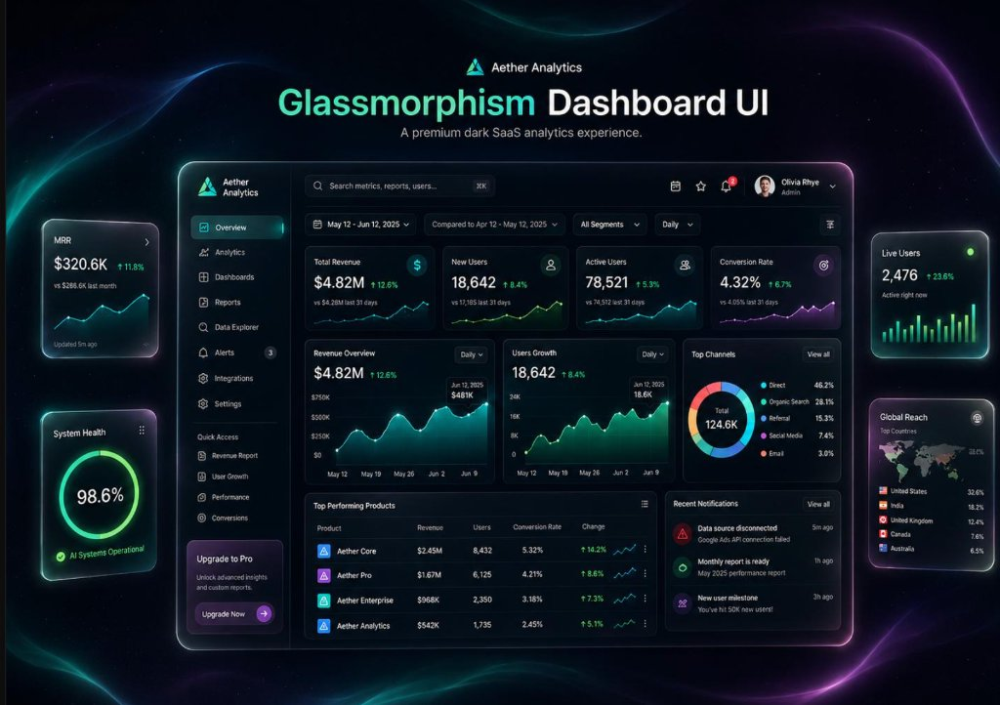

<div align="center">

# ⚡ British Auction RFQ System
### *Enterprise Reverse Bidding & Automatic Deadline Extension Platform*

[](https://fastapi.tiangolo.com/)
[](https://react.dev/)
[](https://tailwindcss.com/)
[](https://www.framer.com/motion/)
[](https://python.org/)
[](#-automated-testing--qa-verification)
[](#)

<p align="center">
  <b>A full-stack, enterprise-grade logistics procurement platform designed to eliminate last-second "bid sniping" through an authoritative, mathematically enforced British Auction automatic extension engine.</b>
</p>

---

[🚀 Quick Start](#-quick-start--local-setup) •
[🔑 Demo Credentials](#-demo-accounts--1-click-login) •
[🧠 British Auction Engine](#-the-british-auction-extension-engine) •
[📸 Live UI Gallery](#-visual-showcase--screenshots) •
[📊 Architecture & Schema](#-architecture--database-design) •
[🧪 Automated Tests](#-automated-testing--qa-verification)

---

</div>

<br />

## 👔 Executive Summary for HR & Technical Evaluators

> **Why this project stands out:**  
> Traditional procurement and reverse-auction systems suffer from **bid sniping**—suppliers withhold their most competitive pricing until the final seconds of an auction, disrupting fair market price discovery.  
> 
> This application solves the problem by implementing a **British Auction Engine** that dynamically extends closing deadlines whenever competitive bidding activity is detected within a designated **Trigger Window (`X` minutes)**, adding `Y` minutes while strictly respecting a hard **Forced Close Time** ceiling.

### 🌟 Core Highlights
- 🛡️ **Authoritative Server Clock**: Zero trust in frontend timers; server-side UTC validation guarantees bulletproof deadline enforcement.
- ⚡ **All 3 Assignment Extension Triggers**: Supports **Type A** (Any Bid), **Type B** (Any Rank Change), and **Type C** (L1 Lowest Bidder Identity Change).
- 🏆 **Deterministic Reverse Leaderboard**: Dynamic `L1`, `L2`, `L3`, ... ranking with automatic tie-breaking (earliest timestamp wins).
- 🎨 **Futuristic Aether 3D Glassmorphism UI**: Inspired by Linear, Stripe, and high-end fintech platforms, featuring interactive 3D tilt cards, circular neon countdown rings, live descending price curve charts, and dark/light modes.
- 🔁 **Instant 1-Click Role Switcher**: Pinned demo bar allows evaluators to toggle between Buyer and 3 competing Suppliers in a single click without typing passwords.

---

## 🔑 Demo Accounts & 1-Click Login

The database is pre-seeded with real-world logistics entities. A **Quick Demo Switcher Bar** is pinned at the top of the app for instantaneous testing.

<div align="center">

| Role | Entity / Carrier | Name | Login Email | Password | Access Level |
| :--- | :--- | :--- | :--- | :--- | :--- |
| <span>BUYER</span> | **Apex Enterprises** | Rajesh Sharma | `buyer@cocomet.com` | `Buyer@123` | Create RFQs, monitor leaderboards, inspect audit logs |
| <span>SUPPLIER 1</span> | **BlueDart Express** | Amit Verma | `supplier1@cocomet.com` | `Supplier@123` | Submit quotes, compete for L1, trigger extensions |
| <span>SUPPLIER 2</span> | **DHL Global Forwarding** | Vikram Singh | `supplier2@cocomet.com` | `Supplier@123` | Submit quotes, underbid competitors |
| <span>SUPPLIER 3</span> | **Maersk Logistics India** | Pooja Patel | `supplier3@cocomet.com` | `Supplier@123` | Submit quotes, review quotation history |

</div>

---

## 📸 Visual Showcase & Screenshots

<br />

### 🎨 Design Benchmark & Futuristic Aether Glassmorphism
*Engineered to reflect next-generation enterprise SaaS aesthetics (Aether Analytics, Linear, Stripe), featuring layered translucency (`backdrop-blur-xl`), subtle 3D card tilt physics, ambient neon lighting, and real-time SVG circular countdown meters.*

<div align="center">
  <table width="100%">
    <tr>
      <td width="50%" align="center">
        
        <br /><br />
        <sub>✨ Aesthetic Benchmark: Aether Glassmorphism Design Standard</sub>
      </td>
      <td width="50%" align="center">
        
        <br /><br />
        <sub>🚀 Live Implementation: British Auction RFQ Enterprise Platform</sub>
      </td>
    </tr>
  </table>
</div>

<br />

### 1. Enterprise Procurement Dashboard (Dark Aether Mode)
*Comprehensive overview featuring interactive 3D tilt KPI cards, a 7-day dual-area bidding activity curve, active auction status badges, and live audit telemetry.*

<div align="center">
  <table width="100%">
    <tr>
      <td align="center">
        
        <br /><br />
        <sub><b>Figure 1.1:</b> Real-time Procurement Analytics, 3D Tilt KPI Cards, Dual-Line Activity Area Chart, and Active RFQ Grid.</sub>
      </td>
    </tr>
  </table>
</div>

<br />

### 2. Live 3D Auction Bidding Room & Circular Countdown
*Live bidding room featuring the circular radial countdown gauge with glowing SVG neon ring, active Trigger Window badge, real-time descending price curve, and itemized leaderboard.*

<div align="center">
  <table width="100%">
    <tr>
      <td width="50%" align="center">
        
        <br /><br />
        <sub><b>Figure 2.1:</b> Showcase Banner with Circular Radial Countdown Gauge & Metric Cards.</sub>
      </td>
      <td width="50%" align="center">
        
        <br /><br />
        <sub><b>Figure 2.2:</b> Live Supplier Leaderboard (L1/L2/L3) & Descending Price Curve.</sub>
      </td>
    </tr>
  </table>
</div>

<br />

### 3. Dynamic Auction Extension & Confetti Celebration
*Visual celebration when a supplier underbids to claim L1 inside the trigger window—triggering confetti bursts, shifting closing deadlines, and logging immutable audit events.*

<div align="center">
  <table width="100%">
    <tr>
      <td align="center">
        
        <br /><br />
        <sub><b>Figure 3.1:</b> Automated British Auction Extension Banner (+1m shift), Real-Time Toast Notification, and Confetti Animation.</sub>
      </td>
    </tr>
  </table>
</div>

<br />

### 4. Quotation Submission & Quick Decrement Helpers
*Supplier quotation submission interface with itemized monetary inputs (Freight, Origin, Destination), instant total auto-calculation, and 1-click quick underbid decrement buttons.*

<div align="center">
  <table width="100%">
    <tr>
      <td align="center">
        
        <br /><br />
        <sub><b>Figure 4.1:</b> Dynamic Charge Calculator (`Freight + Origin + Destination = Total`), Previous Best Anchor, and Quick Decrement Buttons (-₹1,000 / -₹2,500 / -₹5,000).</sub>
      </td>
    </tr>
  </table>
</div>

<br />

### 5. Seamless Dark & Light Mode Theme Architecture

The interface supports both dark and light themes.

<table>
  <tr>
    <th align="center">🌙 Dark Mode</th>
    <th align="center">☀️ Light Mode</th>
  </tr>
  <tr>
    <td width="50%" align="center">
      
    </td>
    <td width="50%" align="center">
      
    </td>
  </tr>
</table>

---

## 🧠 The British Auction Extension Engine

The core business logic resides in `backend/app/services/auction_engine.py`. It executes inside ACID database transactions with row-level locks.

```
       Auction Start                              Original Close                                 Forced Close
             |                                          |                                              |
             +==========================================+----------------------------------------------+
                                                 [-- X min --]
                                                 Trigger Window
                                                       ^
                                            Valid Bidding Activity
                                                       |
                                        +------------------------------+
                                        |  Extend Close by +Y Minutes  |
                                        |  (Capped at Forced Close)    |
                                        +------------------------------+
                                                       |
                                                       v
                                            New Effective Close Time
```

### Mathematical Formulation

An eligible bid can extend the auction only during the configured trigger window:

```text
Effective close - X minutes <= Current server time <= Effective close
```

When the configured trigger condition is met, the new deadline is:

```text
New close = min(Effective close + Y minutes, Forced close)
```

Here, **X** is the trigger-window duration, **Y** is the extension duration, and **Forced close** is the absolute deadline that cannot be exceeded.

### The 3 Configurable Extension Triggers

| Trigger Identifier | Name | Condition for Extension | Real-World Use Case |
| :--- | :--- | :--- | :--- |
| **Type A** | `BID_RECEIVED` | Any valid quotation placed within the last `X` minutes. | High-frequency spot freight; maximum participation. |
| **Type B** | `ANY_RANK_CHANGE` | Any supplier shifts rank (`L3 → L2`, `L2 → L1`). | Mid-market logistics; prevents rank stagnation. |
| **Type C** | `L1_RANK_CHANGE` | Identity of lowest bidder (`L1`) changes. Self-lowering by existing `L1` does **not** extend. | High-value capital freight; only extends when leader is dethroned. |

### The Forced Close Hard Ceiling
An auction must never run indefinitely. Buyers establish a hard `forced_close_time`. When the wall-clock reaches this timestamp:
1. Status transitions to `FORCE_CLOSED`.
2. The bidding API rejects all new submissions with HTTP 400.
3. The bidding console is automatically disabled.
4. Final ranks are locked permanently for contract awarding.

---

## 📊 Architecture & Database Design

### System Architecture

```mermaid
graph LR
    subgraph Frontend ["Frontend Tier (React + Vite + TS)"]
        UI_Dash["Procurement Dashboard"]
        UI_Room["3D Auction Room"]
        UI_Gauge["Circular Countdown"]
        UI_Poll["Reactive Polling (2s)"]
    end

    subgraph Backend ["Backend Tier (FastAPI + Python 3.11)"]
        API_Auth["JWT Auth & RBAC"]
        API_RFQ["RFQ Lifecycle Engine"]
        API_Rank["Deterministic Ranking"]
        API_Ext["British Auction Engine"]
    end

    subgraph Database ["Data Tier (SQLAlchemy ORM)"]
        DB_Users[("users & suppliers")]
        DB_RFQs[("rfqs & auction_configs")]
        DB_Bids[("quotations")]
        DB_Logs[("auction_activity_logs")]
    end

    Frontend <-->|REST APIs / Bearer JWT| Backend
    Backend <-->|ACID Transactions| Database
```


### Relational Database Schema
- **`users`**: User identities, bcrypt hashed credentials, and role flags (`BUYER`, `SUPPLIER`).
- **`suppliers`**: Corporate carrier profiles, dispatch contacts, linked to `users.id`.
- **`rfqs`**: Service requirements, cargo title, `bid_start_time`, `original_close_time`, `current_close_time`, and `forced_close_time`.
- **`auction_configurations`**: 1-to-1 relationship with `rfqs`, storing `trigger_window_minutes` (`X`), `extension_duration_minutes` (`Y`), and `extension_trigger_type`.
- **`quotations`**: Immutably preserves every quote: `Freight + Origin + Destination = Total`, transit time, validity, and timestamps.
- **`auction_activity_logs`**: Chronological audit trail logging events: `AUCTION_CREATED`, `BID_SUBMITTED`, `RANKING_CHANGED`, `AUCTION_EXTENDED`, `AUCTION_CLOSED`, `AUCTION_FORCE_CLOSED`.

Detailed ER diagram and schema specifications are documented in [docs/DATABASE_SCHEMA.md](docs/DATABASE_SCHEMA.md).

---

## 🧪 Automated Testing & QA Verification

The backend test suite runs via Pytest with an in-memory SQLite database and FastAPI TestClient.

```bash
# Execute the full automated test suite:
PYTHONPATH=backend backend/venv/bin/pytest backend/tests -v
```

<div align="center">

| Test Suite File | Test Objective | Result |
| :--- | :--- | :---: |
| `test_auction_engine.py` | **Trigger Type A**: Verifies extension on valid bid inside trigger window | <span>PASSED ✅</span> |
| `test_auction_engine.py` | **Trigger Type B**: Verifies extension only occurs when rank shifts | <span>PASSED ✅</span> |
| `test_auction_engine.py` | **Trigger Type C**: Verifies L1 identity change; confirms L1 self-lowering does NOT extend | <span>PASSED ✅</span> |
| `test_auction_engine.py` | **Forced Close Capping**: Confirms `min(close + Y, forced_close)` ceiling | <span>PASSED ✅</span> |
| `test_ranking.py` | **Deterministic Ranking**: Verifies L1/L2/L3 order and timestamp tie-breaking | <span>PASSED ✅</span> |
| `test_rfq.py` | **Time Boundary Validation**: Enforces `Start < Close < Forced Close` | <span>PASSED ✅</span> |
| `test_rfq.py` | **RBAC Authorization**: Rejects RFQ creation attempts by Suppliers | <span>PASSED ✅</span> |
| `test_auth.py` | **JWT Security**: Registration, bcrypt validation, profile extraction | <span>PASSED ✅</span> |
| `test_bidding_api.py` | **E2E Reverse Bidding**: Multi-supplier quote race, leaderboard shifts, audit stream | <span>PASSED ✅</span> |
| `frontend/build` | **TypeScript Compilation**: Zero errors across types, JSX, and Tailwind | <span>PASSED ✅</span> |

</div>

---

## ⏱️ 60-Second Evaluator Demo Script

Follow this script to see the automatic extension in action:

1. **Launch the Web App**: Open [http://localhost:5173](http://localhost:5173) in your browser.
2. **Login as Buyer**: Click **`Buyer (Apex)`** on the top Quick Demo Bar.
3. **Open Fast-Demo RFQ**:
   - Go to **All RFQ Auctions** and click on **`RFQ-FAST-001`** *(Urgent Pharma Freight)*.
   - Note the **Circular Countdown Gauge**: If the timer is within 2 minutes, you will see a pulsing yellow alert: `TRIGGER WINDOW ACTIVE (2m)`.
4. **Switch to Supplier 2 (DHL)**: Click **`Supplier 2 (DHL)`** on the top demo bar.
5. **Submit an Underbid**:
   - In the quotation card, click the quick underbid button **`-₹2,500`** (or enter Freight: `30000`, Origin: `4000`, Dest: `3000` = `₹37,000`).
   - Click **Place Official Quotation**.
6. **Watch the Engine React**:
   - 🎉 **Confetti Cannon fires** celebrating the new `L1` leader.
   - ⚡ **Extension Banner appears**: *"British Auction Automatic Extension Triggered!"*
   - ⏱️ **Countdown Timer updates**: The deadline extends by 1 minute.
   - 📜 **Live Activity Timeline records**: An `AUCTION_EXTENDED` event appears in the audit log.

---

## 📁 Repository Deliverables Index

Per the assignment specification, all core deliverables are provided in the repository:

- 📄 **Deliverable 1: High-Level Design (HLD)**: [`docs/HLD.md`](docs/HLD.md)
- 🗄️ **Deliverable 2: Database Schema & ERD**: [`docs/DATABASE_SCHEMA.md`](docs/DATABASE_SCHEMA.md)
- 🐍 **Deliverable 3: Backend Source Code**: [`backend/app/`](backend/app)
- ⚛️ **Deliverable 4: Frontend Source Code**: [`frontend/src/`](frontend/src)

---

## 🚀 Quick Start & Local Setup

### 1. Backend Service
```bash
cd backend
python3 -m venv venv
source venv/bin/activate       # On Windows: venv\Scripts\activate
pip install -r requirements.txt
python seed.py                 # Seeds demo accounts & RFQs
uvicorn app.main:app --host 0.0.0.0 --port 8000 --reload
```
*API is accessible at `http://localhost:8000/api` (Swagger UI at `/api/docs`).*

### 2. Frontend Service
```bash
cd frontend
npm install
npm run dev
```
*Web Application is accessible at `http://localhost:5173`.*

---

<div align="center">

### Built with care for high-throughput logistics procurement.  
**British Auction RFQ System © 2026**

</div>
