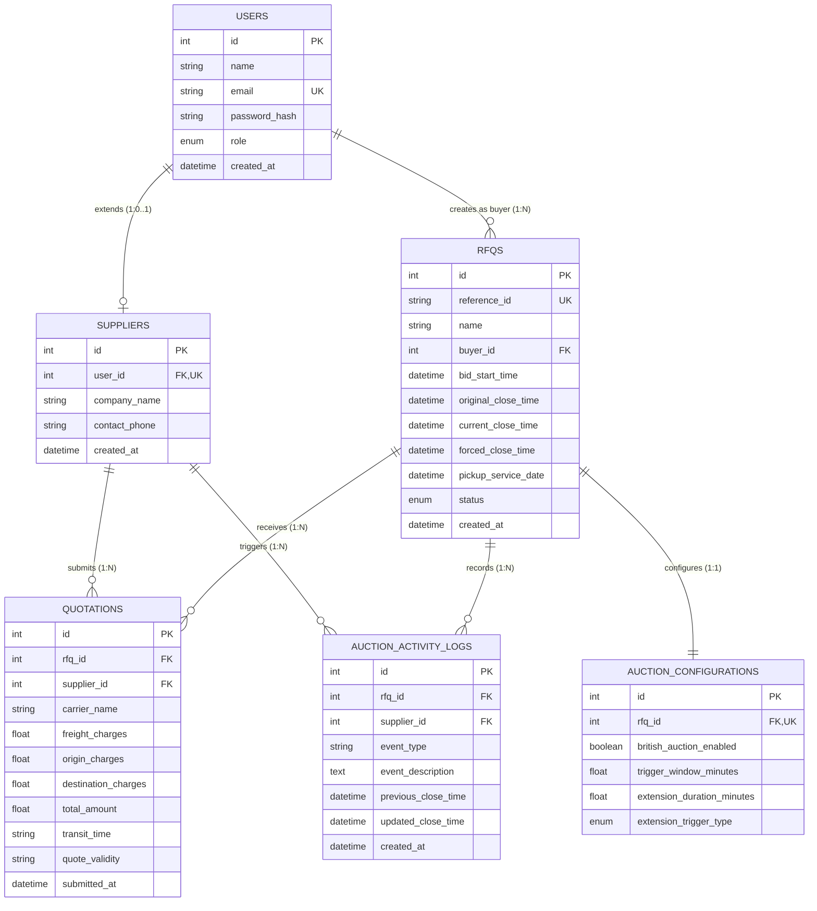

# Database Schema Design: British Auction RFQ System

## 1. Schema Overview & Relational Architecture

The database is designed with full 3NF (Third Normal Form) normalization, strict referential integrity, cascading rules, and deterministic indexing. It supports seamless migration between local SQLite development and enterprise PostgreSQL production environments.

---

## 2. Entity-Relationship (ER) Diagram

---

## 3. Table Definitions & Specifications

### 3.1 `users` Table
Stores authenticated user accounts for both Buyers and Suppliers.
| Column | Type | Constraints | Description |
| :--- | :--- | :--- | :--- |
| `id` | `INTEGER` | `PRIMARY KEY, AUTOINCREMENT` | Unique user identifier |
| `name` | `VARCHAR(100)` | `NOT NULL` | Full legal / representative name |
| `email` | `VARCHAR(255)` | `UNIQUE, NOT NULL, INDEX` | Unique email for authentication |
| `password_hash` | `VARCHAR(255)` | `NOT NULL` | Bcrypt password hash |
| `role` | `VARCHAR(20)` | `NOT NULL` | Enum: `BUYER`, `SUPPLIER` |
| `created_at` | `DATETIME` | `NOT NULL, DEFAULT UTC_NOW` | Account registration timestamp |

### 3.2 `suppliers` Table
Stores corporate logistics profiles associated with users having the `SUPPLIER` role.
| Column | Type | Constraints | Description |
| :--- | :--- | :--- | :--- |
| `id` | `INTEGER` | `PRIMARY KEY, AUTOINCREMENT` | Supplier entity ID |
| `user_id` | `INTEGER` | `FOREIGN KEY (users.id), UNIQUE, NOT NULL` | Associated User account |
| `company_name` | `VARCHAR(150)` | `NOT NULL` | Corporate carrier or freight name |
| `contact_phone` | `VARCHAR(50)` | `NULLABLE` | Official dispatch contact number |
| `created_at` | `DATETIME` | `NOT NULL, DEFAULT UTC_NOW` | Profile creation timestamp |

### 3.3 `rfqs` Table
Core Request for Quotation records created by Buyers.
| Column | Type | Constraints | Description |
| :--- | :--- | :--- | :--- |
| `id` | `INTEGER` | `PRIMARY KEY, AUTOINCREMENT` | RFQ identifier |
| `reference_id` | `VARCHAR(50)` | `UNIQUE, NOT NULL, INDEX` | Human-readable ID (e.g. `RFQ-2026-001`) |
| `name` | `VARCHAR(200)` | `NOT NULL` | Service/cargo title |
| `buyer_id` | `INTEGER` | `FOREIGN KEY (users.id), NOT NULL` | Creator buyer account |
| `bid_start_time` | `DATETIME` | `NOT NULL` | Opening of the bidding window |
| `original_close_time`| `DATETIME` | `NOT NULL` | Initial scheduled closing time |
| `current_close_time` | `DATETIME` | `NOT NULL, INDEX` | Effective deadline (updated on extension)|
| `forced_close_time`  | `DATETIME` | `NOT NULL` | Absolute ceiling deadline |
| `pickup_service_date`| `DATETIME` | `NOT NULL` | Required service execution date |
| `status` | `VARCHAR(20)` | `NOT NULL, DEFAULT 'UPCOMING'` | Enum: `UPCOMING`, `ACTIVE`, `CLOSED`, `FORCE_CLOSED` |
| `created_at` | `DATETIME` | `NOT NULL, DEFAULT UTC_NOW` | RFQ creation timestamp |

### 3.4 `auction_configurations` Table
British Auction parameters governing automatic extension logic.
| Column | Type | Constraints | Description |
| :--- | :--- | :--- | :--- |
| `id` | `INTEGER` | `PRIMARY KEY, AUTOINCREMENT` | Configuration ID |
| `rfq_id` | `INTEGER` | `FOREIGN KEY (rfqs.id), UNIQUE, NOT NULL` | Linked RFQ |
| `british_auction_enabled` | `BOOLEAN` | `NOT NULL, DEFAULT TRUE` | Extension feature toggle |
| `trigger_window_minutes` | `FLOAT` | `NOT NULL, DEFAULT 10.0` | Trigger monitoring window $X$ |
| `extension_duration_minutes` | `FLOAT` | `NOT NULL, DEFAULT 5.0` | Extension addition $Y$ |
| `extension_trigger_type` | `VARCHAR(30)` | `NOT NULL, DEFAULT 'BID_RECEIVED'` | Enum: `BID_RECEIVED`, `ANY_RANK_CHANGE`, `L1_RANK_CHANGE` |

### 3.5 `quotations` Table
Chronological log of all bids submitted by suppliers. Every bid is preserved.
| Column | Type | Constraints | Description |
| :--- | :--- | :--- | :--- |
| `id` | `INTEGER` | `PRIMARY KEY, AUTOINCREMENT` | Quotation record ID |
| `rfq_id` | `INTEGER` | `FOREIGN KEY (rfqs.id), NOT NULL, INDEX` | Linked RFQ |
| `supplier_id` | `INTEGER` | `FOREIGN KEY (suppliers.id), NOT NULL, INDEX` | Submitting supplier |
| `carrier_name` | `VARCHAR(100)` | `NOT NULL` | Dedicated carrier line |
| `freight_charges` | `FLOAT` | `NOT NULL, >= 0` | Base freight cost |
| `origin_charges` | `FLOAT` | `NOT NULL, >= 0` | Origin handling/duties |
| `destination_charges` | `FLOAT` | `NOT NULL, >= 0` | Destination handling/unloading |
| `total_amount` | `FLOAT` | `NOT NULL, INDEX` | Computed: Freight + Origin + Dest |
| `transit_time` | `VARCHAR(50)` | `NOT NULL` | SLA (e.g. `2 Business Days`) |
| `quote_validity` | `VARCHAR(50)` | `NOT NULL` | Validity period (e.g. `15 Days`) |
| `submitted_at` | `DATETIME` | `NOT NULL, DEFAULT UTC_NOW, INDEX` | Timestamp of submission |

**Composite Index**: `ix_rfq_supplier_submitted (rfq_id, supplier_id, submitted_at DESC)` for instantaneous leaderboard calculation.

### 3.6 `auction_activity_logs` Table
Immutable audit trail of auction lifecycle events.
| Column | Type | Constraints | Description |
| :--- | :--- | :--- | :--- |
| `id` | `INTEGER` | `PRIMARY KEY, AUTOINCREMENT` | Audit log entry ID |
| `rfq_id` | `INTEGER` | `FOREIGN KEY (rfqs.id), NOT NULL, INDEX` | Linked RFQ |
| `supplier_id` | `INTEGER` | `FOREIGN KEY (suppliers.id), NULLABLE` | Supplier triggering event (if any) |
| `event_type` | `VARCHAR(50)` | `NOT NULL` | e.g. `AUCTION_EXTENDED`, `BID_SUBMITTED`, `RANKING_CHANGED`, `AUCTION_CLOSED`, `AUCTION_FORCE_CLOSED` |
| `event_description` | `TEXT` | `NOT NULL` | Human-readable audit narrative |
| `previous_close_time` | `DATETIME` | `NULLABLE` | Closing deadline prior to event |
| `updated_close_time` | `DATETIME` | `NULLABLE` | Closing deadline after event |
| `created_at` | `DATETIME` | `NOT NULL, DEFAULT UTC_NOW, INDEX` | Event timestamp |

---

## 4. Design Highlights & PostgreSQL Compatibility

1. **Monetary Precision**: All numeric amounts are validated against negative numbers and rounded to 2 decimal places. In PostgreSQL, these map directly to `NUMERIC(14, 2)`.
2. **UTC Timestamp Standardization**: All times are stored in UTC format.
3. **Optimistic Locking / Row Locking**: Queries in `auction_engine.py` use `with_for_update()` under PostgreSQL for concurrency control.
4. **Deterministic Ranking**: Rankings query the latest quotation per supplier per RFQ and order by `(total_amount ASC, submitted_at ASC)`.
