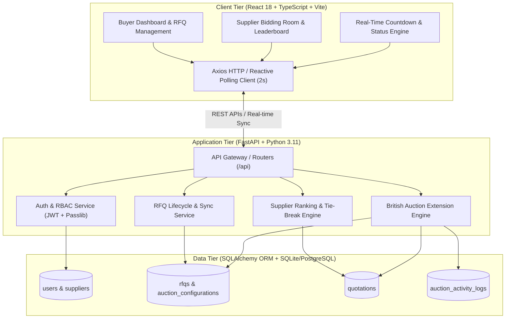
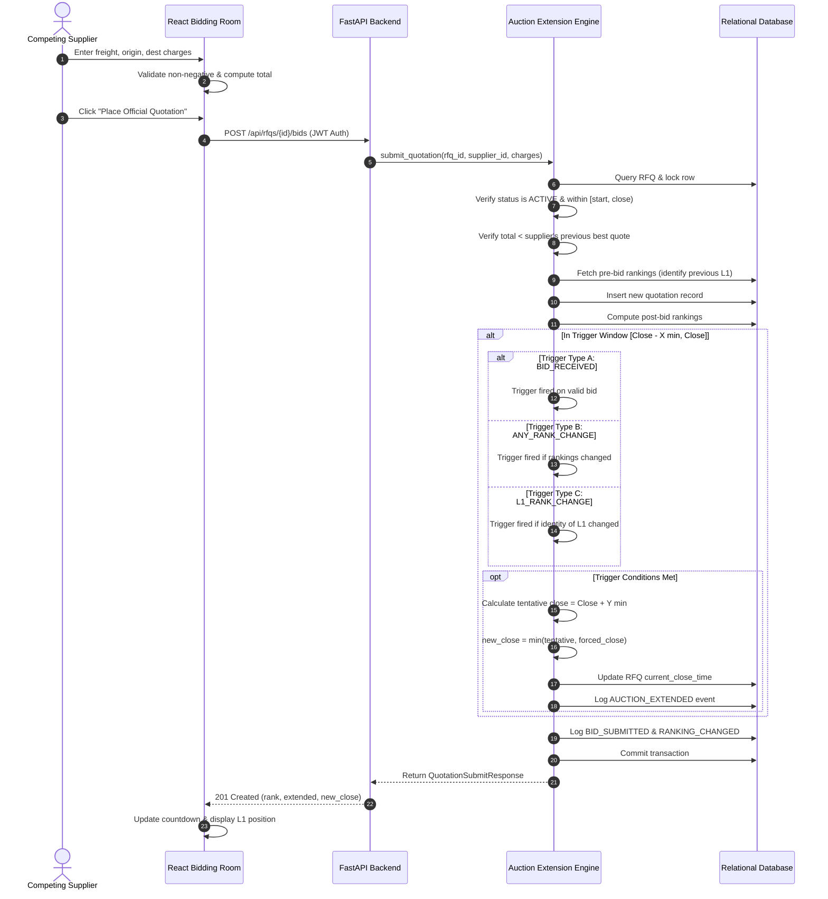

# High-Level Design (HLD): British Auction RFQ System

## 1. System Overview

The **British Auction RFQ System** is an enterprise-grade procurement and reverse bidding platform designed for freight and logistics operations. In this system, buyers create Requests for Quotation (RFQs) specifying service requirements and auction rules. Multiple pre-qualified logistics suppliers (carriers) compete openly by submitting progressively lower quotes (freight charges, origin charges, destination charges).

The core technical differentiator is the **British Auction Automatic Extension Engine**. To eliminate "bid sniping" (last-second predatory submissions) and encourage optimal price discovery, any qualifying bidding activity detected inside a configurable **Trigger Window ($X$ minutes)** automatically extends the auction deadline by an **Extension Duration ($Y$ minutes)**, capped at a hard **Forced Close Time**.

---

## 2. Architecture Diagram

---

## 3. Component Responsibilities

### 3.1 Frontend Tier (Client)
- **Role-Based Views**: Dynamic UI states tailored for Buyers (RFQ creation, participant oversight, activity audit) and Suppliers (quotation submission, real-time rank feedback).
- **Countdown & Trigger Window Visualizer**: Live countdown clock that changes state and pulses an alert when the current time enters the $[T_{close} - X, T_{close}]$ trigger window.
- **Reactive Polling Layer**: Automatically syncs leaderboard rankings, current lowest bid ($L1$), and activity logs every 2 seconds without full-page reloads.
- **Form Auto-Calculation**: Calculates $Total = Freight + Origin + Destination$ live as numbers are typed, preventing invalid input.

### 3.2 Backend Tier (FastAPI Application)
- **Authentication & RBAC**: Issues signed JWT tokens distinguishing `BUYER` and `SUPPLIER` roles.
- **Ranking Engine**: Computes deterministic reverse-auction leaderboards ($L1, L2, L3 \dots$). Sorts by `total_amount ASC` with deterministic tie-breaking by `submitted_at ASC`.
- **British Auction Extension Engine**: The authoritative state machine evaluating Trigger Types A, B, and C against the server's UTC clock.
- **Forced Close Governor**: Enforces $\text{new\_close} = \min(T_{close} + Y, T_{forced\_close})$, preventing runaway extensions.
- **Activity & Audit Logger**: Every extension, rank change, and bid is immutably recorded with before/after timestamps and detailed contextual reasons.

---

## 4. Auction Bidding & Extension Workflow

---

## 5. British Auction Extension Rules

### 5.1 Trigger Window ($X$ Minutes)
The trigger window monitors activity in the interval $[T_{close} - X, T_{close}]$.
Critically, $X$ is evaluated against the **current effective closing time** (which accounts for prior extensions), not just the original start-of-day deadline.

### 5.2 Extension Duration ($Y$ Minutes)
When a configured trigger condition fires inside the window, the auction closing time is pushed by $Y$ minutes:
$$T_{new\_close} = T_{current\_close} + Y$$

### 5.3 Extension Trigger Types
| Trigger Type | Description | Extension Condition |
| :--- | :--- | :--- |
| **Type A: `BID_RECEIVED`** | Any bid in last $X$ minutes | Any valid quotation submitted in trigger window |
| **Type B: `ANY_RANK_CHANGE`** | Any rank change in last $X$ minutes | Any supplier moves position ($L2 \to L1$, $L3 \to L2$, etc.) |
| **Type C: `L1_RANK_CHANGE`** | Lowest bidder ($L1$) identity change | Identity of lowest-priced supplier changes. If current $L1$ lowers own bid and stays $L1$, does **not** extend. |

### 5.4 Forced Close Hard Ceiling
An auction must never extend indefinitely. The buyer configures a $T_{forced\_close} > T_{close}$.
$$T_{new\_close} = \min(T_{current\_close} + Y, T_{forced\_close})$$
When $T \ge T_{forced\_close}$, the auction status transitions to `FORCE_CLOSED`, the bidding interface disables immediately, and no further bids are accepted under any circumstance.

---

## 6. Technology Decisions & Rationale

- **FastAPI + Pydantic V2**: Provides automatic request validation, high-throughput asynchronous execution, and standard OpenAPI documentation.
- **SQLAlchemy 2.0**: Enterprise ORM ensuring ACID-compliant transactions, explicit connection pooling, and seamless migration from SQLite to PostgreSQL.
- **React 18 + Vite + Tailwind CSS**: Zero-latency compilation, atomic utility CSS, and responsive enterprise dashboard aesthetic with dark navy accents.
- **Lucide Icons & Recharts**: High-fidelity procurement data visualizations and accessible interface symbols.
